# IncidentLens Design Evolution

## Purpose
IncidentLens is a learning project for designing, implementing, evaluating, and explaining a multi-agent incident investigation assistant. It will analyze synthetic or public telemetry and produce evidence-linked incident reports while keeping remediation read-only or simulated behind human approval.

## Design principles
- Start with deterministic behavior and a single-agent baseline before adding multiple agents.
- Add an agent only when specialization is justified by different context, tools, permissions, or reasoning responsibility.
- Treat telemetry, runbooks, model output, and retrieved content as untrusted until validated.
- Preserve evidence provenance through stable IDs rather than relying on agent prose.
- Keep hidden ground truth outside every agent-visible path.
- Prefer explicit state, bounded tools, and deterministic guards around probabilistic model calls.
- Keep lifecycle transitions, authorization, validation, budgets, and human approval in deterministic application code.

## Current architecture snapshot
- Roadmap module and implementation status: Module 14 completed; Module 15 is in Build. The repository contains a deterministic single-agent baseline, provider-neutral telemetry tools, scoped specialist contracts and registries, parallel coordinator runtime, persistence/checkpoint boundaries, hypothesis/report acceptance, approval contracts, resilience/error boundaries, reproducible synthetic fixtures, and the first versioned evaluation harness.

### Component and agent summary
Implemented components:
- `src/incidentlens/contracts.py`: Pydantic contracts for incidents, evidence, hypotheses, reports, and model responses.
- `src/incidentlens/tools.py`: fixture-backed read-only tool and tool registry.
- `src/incidentlens/agent_loop.py`: deterministic loop runner that calls a model client, validates model responses, executes validated tools, stores observations, propagates permitted tool execution failures, and enforces max-step termination.
- `src/incidentlens/config.py`: settings boundary for Gemini model name, API key, max steps, retry count, and retry timing.
- src/incidentlens/telemetry.py: versioned provider-neutral telemetry and manifest contracts with evaluator-to-agent projection.
- `fixtures/incidents/payment_latency.json`: small synthetic fixture.
- `tests/test_agent_loop.py`: focused tests for happy path, unknown tools, malformed args, max-step termination, and invalid evidence references, malformed model output, and permitted tool execution errors.
- `src/incidentlens/coordination.py` and `src/incidentlens/parallel_investigation.py`: task envelopes, bounded budgets, follow-up validation, scoped fan-out/fan-in, circuit-breaker integration, and `CoordinatorRuntime`.
- `src/incidentlens/specialist_runtime.py`: provider-neutral worker composition using role-specific model clients and tool registries.
- `src/incidentlens/hypotheses.py` and `src/incidentlens/contracts.py`: evidence-grounded hypothesis verification and deterministic report acceptance.
- `src/incidentlens/persistence.py` and `src/incidentlens/approval.py`: bounded artifacts, checkpoint compatibility checks, approval fingerprints, resume protection, and sanitized audit events.
- `src/incidentlens/errors.py` and `src/incidentlens/reliability.py`: sanitized provider-neutral errors and scoped circuit breakers.

Remaining proposed components:
- Module 15 evaluation harness, ablations, observability, and cost estimation
- Module 16 FastAPI job/API boundary, live OpenTelemetry integration, and local deployment

### Agent responsibilities, context, tools, and permissions
The `ModelClient` protocol and Gemini/LangChain adapter are implemented. Specialist workers receive role-scoped contexts and registries; deterministic coordinator code owns task scope, budgets, tool execution, lifecycle, and report acceptance. Model-backed specialist execution accepts caller-supplied role adapters and never receives direct execution authority.

Implemented boundaries:
- Logs specialist: log evidence only unless explicitly delegated cross-signal context.
- Metrics specialist: metric evidence only unless explicitly delegated cross-signal context.
- Traces specialist: trace/span evidence only unless explicitly delegated cross-signal context.
- Change specialist: deployment and configuration events.
- Verification component: checks hypotheses against evidence and searches for contradictions, rather than merely agreeing or disagreeing.
- Synthesis component: writes report claims only from structured findings and evidence IDs.

### State and artifact ownership
Graph state owns lifecycle, bounded references, specialist branch results, usage counters, and sanitized failure details. `ArtifactStore` owns versioned evidence/report artifacts; `CheckpointStore` owns resumable state and rejects incompatible state/tool contracts. Long-term cross-investigation memory is intentionally not implemented.

### Incident investigation flow
Top-level lifecycle: `created -> investigating -> awaiting_review -> completed | failed | cancelled`.

Possible internal phases inside `investigating`: triage, specialist investigation, aggregation, verification, and synthesis. These are not top-level states unless the roadmap is explicitly changed.

### Inter-agent contracts
Versioned task envelopes, specialist findings, evidence tables, hypotheses, verification results, branch results, and provider-neutral errors are implemented. Findings are validated for task, incident, role, and evidence scope before aggregation.

### Persistence and recovery
Filesystem-backed artifacts and checkpoints are implemented and tested. LangGraph checkpoint integration supports interrupt/resume; incompatible state and tool-contract versions are rejected before execution. External transactional storage remains a Module 16 concern.

### Security and human-approval boundaries
Core system is read-only. Any remediation remains proposed/simulated until later modules add explicit human approval bound to exact action arguments and evidence.

### Evaluation and observability
Module 15 now includes evaluator-owned scenario contracts, safe agent projections, held-out fixture selection, deterministic grounding/abstention checks, aggregate metrics, a deterministic fixture-backed baseline runner, trajectory scoring, persisted comparable run sets, named adapters for all four comparison variants, a concrete `SingleAgentRunner` over the bounded agent loop, a `MultiAgentRunner` over `CoordinatorRuntime` with the existing deterministic `VerifierAgent`, an explicit `MultiAgentWithoutVerifierRunner` ablation, aligned variant delta calculations, repeated-trial aggregation with fresh runner factories, a frozen held-out evaluation entry point, human/judge calibration contracts, and an offline scripted model mode for reproducible plumbing comparisons. Gemini remains the sole live model provider. Failed reports are excluded from grounded and successful-abstention rates. Live provider failures remain visible through recovery and sanitized branch-error metrics. The specialist worker remains injected; graph-wide observability and trustworthy live cost estimation remain in progress.

### High-level diagram
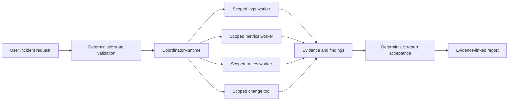

### Known limitations
- Full pytest/Ruff validation must be rerun in an environment with project dependencies installed; the current environment only confirmed Python compilation and diff cleanliness.
- Model-backed specialist workers require caller-supplied adapters, and model-backed verifier quality must be compared against deterministic acceptance in Module 15.
- A centralized generic audit sink for every dependency event is not yet implemented; structured sanitized error data is available at the boundaries.
- Evaluation, cost estimation, live telemetry, API productization, and deployment remain Modules 15–16 work.

## Module-by-module design history

### Module 1 - Multi-agent foundations and project contract
- Status: Completed

#### Before this module
The repository contained `roadmap.md`, `AGENTS.md`, and an empty `.dist` directory. The required learning records did not exist.

#### What changed
Initialized the required learning records and captured the proposed starting lifecycle, project contract, and architecture boundary.

Project contract:
- Problem statement: Incident investigation is slow because evidence is scattered across logs, metrics, traces, deployment history, and service context. IncidentLens coordinates bounded specialist investigations and produces an evidence-backed diagnosis instead of relying on unsupported agent prose.
- Actors: on-call engineer/SRE; planned IncidentLens coordinator; logs, metrics, traces, and deployment/change specialists; synthesis/root-cause component.
- Inputs: incident description or alert, affected service, time window, logs, metrics, traces, recent deployments/config changes, and service/dependency metadata.
- Outputs: incident summary, likely root cause with calibrated confidence, supporting and contradicting evidence references, investigation timeline, affected components, competing hypotheses, and inconclusive result when evidence is insufficient.
- Constraints: Python, Gemini API, LangChain allowed, LangGraph preferred for explicit state/routing/parallelism/persistence/interrupts, synthetic/public/deliberately created telemetry only, read-only core, evidence separated from inference, bounded investigation cost/time/tool/model calls, graceful degradation for individual agent failures.
- Non-goals: automatic production changes, replacing monitoring platforms, fully autonomous remediation, guaranteed root-cause identification, building a full observability backend, or using confidential employer telemetry.
- Lifecycle: `created -> investigating -> awaiting_review -> completed | failed | cancelled`.
- System boundary: IncidentLens consumes telemetry and operational context through bounded read-only tools/APIs, coordinates specialist investigations, validates and aggregates findings, and produces an investigation report. Telemetry generation/storage, alert generation, production remediation, and monitored applications remain outside the core system.

Representative incident narratives:
- Database exhaustion: API latency and 5xx errors spike. Metrics identify exhausted database connections, logs show connection acquisition timeouts, and traces localize latency to database calls. Expected outcome: connection-pool exhaustion is identified with correlated evidence.
- Bad deployment: Errors begin shortly after a deployment. Change analysis identifies the release while logs and traces show failures only in the new version. Expected outcome: deployment is identified as the likely trigger, with rollback proposed only as simulated or approval-bound remediation.
- Misleading symptom: API latency rises and initially appears database-related, but database metrics are healthy. Traces reveal a slow downstream payment service and logs confirm upstream timeouts. Expected outcome: IncidentLens rejects the initial database hypothesis and attributes the incident to the downstream dependency with uncertainty and evidence references.

#### Why it changed
The roadmap requires durable progress, learning, and design records before beginning guided work. Module 1 establishes boundaries before code is added.

#### Alternatives considered
No runtime scaffold was created. This keeps Module 1 focused on the project contract rather than premature implementation.

Triaging and synthesizing were considered as lifecycle states. They were kept as internal phases because the roadmap defines the canonical top-level lifecycle.

#### Ownership and boundary decisions
Application workflow code owns known lifecycle transitions, validation, budgets, authorization, and approval gates. Agents, when added later, must be bounded by specific tools, context, permissions, and structured outputs.

#### Agent, tool, state, API, and compatibility impact
No runtime impact yet. Future Module 2 code must preserve the boundary between model-requested actions and application-executed tools.

#### Failure and security implications
Weak designs to avoid:
- Agents with blurry all-tool access.
- Shared long conversation history across specialists.
- Persona-only skeptics.
- Final reports without evidence IDs.
- Planner agents that own lifecycle transitions.

The preferred direction is deterministic orchestration with isolated specialist context, least-privilege tool access, structured findings, evidence storage, verification, and grounded synthesis.

#### Verification and evidence
Commands observed on 2026-09-10:
- `Get-ChildItem -Force`: showed `.dist`, `AGENTS.md`, `docs`, and `roadmap.md`.
- `git status --short`: failed with `fatal: not a git repository`.
- Reads for required docs files failed before initialization because the files were absent.
- Required docs were created and read back.

Source review:
- LangChain Multi-agent page: multi-agent systems are useful for context management, independently maintained capabilities, and parallelization, but not every complex task requires multiple agents.
- Anthropic Building effective agents: workflows follow predefined code paths; agents dynamically direct their own process/tool use; start with the simplest solution that works because agentic systems trade latency/cost for performance.
- AutoGen Agent and Multi-Agent Applications: an agent communicates via messages, maintains state, and acts in response to messages or state changes; multi-agent applications coordinate self-contained agents toward shared goals.

#### Known limitations after this module
No runtime architecture exists yet. Python tooling, Gemini adapter, schemas, fixtures, tests, persistence, evaluation, and observability are deferred to later modules.

#### Next design step
Module 3: define telemetry-neutral evidence schemas and realistic recorded fixtures.
### Module 2 - Gemini agent loop and single-agent baseline
- Status: Completed

#### Before this module
Module 1 had only documentation and proposed architecture. There was no Python package, schema, tool registry, fixture, or runtime loop.

#### What changed
Added a minimal local baseline increment:
- Python project metadata in `pyproject.toml`.
- Package under `src/incidentlens/`.
- Pydantic contracts for incident input, evidence, hypotheses, investigation reports, tool calls, and model responses.
- A read-only fixture lookup tool over `fixtures/incidents/payment_latency.json`.
- A `ToolRegistry` that rejects unknown tools and validates tool arguments/results.
- A deterministic `run_agent_loop` function that invokes a model client, executes validated tool calls, returns final reports, and raises on max-step exhaustion.
- Focused tests in `tests/test_agent_loop.py`.

#### Why it changed
Module 2 requires a single-agent baseline and proof that application code, not the model, owns tool execution, validation, and termination. A scripted model client makes those boundaries testable before adding live Gemini calls or secrets.

#### Alternatives considered
A live Gemini call could have been implemented first, but that would make early validation depend on network access, an API key, and model variability. The chosen approach isolates deterministic loop behavior first, then leaves the Gemini adapter as the next increment.

#### Ownership and boundary decisions
The model client owns proposing `ModelToolRequest` or `ModelFinalReport`. Application code owns allowed tool names, argument validation, tool execution, result validation, observations, max-step termination, and final schema validation.

#### Agent, tool, state, API, and compatibility impact
The current loop is model-provider agnostic through the `ModelClient` protocol. The Gemini/LangChain adapter is isolated in `src/incidentlens/model_adapter.py`. `src/incidentlens/config.py` sets a configurable default Gemini model of `gemini-3-flash-preview`, verified against current Google model docs as a stable model with function calling and structured output support. API keys are read from settings and are not hard-coded.

#### Failure and security implications
Covered failures:
- Unknown tool request is rejected before execution.
- Malformed tool arguments fail Pydantic validation.
- Runaway tool requests stop at max steps.
- Reports that cite unknown evidence IDs fail validation.

Not yet covered:
- Live model malformed output parsing.
- Tool handler exceptions in loop tests.
- Rate limits, retries, token/cost budgets, and secret handling beyond configuration boundary.

#### Verification and evidence
Commands observed:
- `python --version`: Python 3.12.0.
- `py --version`: Python 3.12.0.
- `python -m pytest -q`: 12 passed, with one local google-auth/grpcio FutureWarning.
- `python -m ruff check .`: passed.
- `python -m ruff format --check .`: passed.
- `python -m mypy src`: failed because `mypy` is not installed.
- `PYTHONPATH=src` config import returned `gemini-3-flash-preview`.

#### Known limitations after this module
The adapter preserves tool-call/result message identity and classifies provider failures behind a sanitized internal enum. Offline retry tests verify attempts, retry counts, capped delay, budget consumption, and null token metadata. The bounded live run reached the configured model twice but ended with schema-invalid output, so no live baseline artifact exists. The fixture remains intentionally small and synthetic.

#### Next design step
Module 3: define telemetry-neutral evidence schemas and realistic recorded fixtures.

#### Module 2 retry follow-up
The final review added ProviderRetryMetadata to the run artifact. Deterministic loop code owns retry count, capped exponential delay, model-call budget, and provider-failure classification. Raw provider messages are not serialized. The baseline runner forwards retry settings from Settings. Offline validation observed 20 tests passed and Ruff check/format check passed. Live validation reached Gemini twice but produced InvalidModelResponseError, so no live baseline artifact exists.

#### Live test boundary
The Gemini integration test is separated from unit tests in tests/test_live_gemini.py. Pytest registers a live marker, and the test additionally requires RUN_LIVE_GEMINI=1. Normal validation therefore cannot spend provider quota accidentally; explicit live runs still use the same deterministic baseline and retry boundaries.

#### Live parser and quota follow-up
The adapter now accepts an optional Markdown JSON fence and a bare report-shaped JSON object, then still applies the strict Pydantic response contract. A live run passed this parser boundary but exhausted the provider quota with HTTP 429 after bounded retries. No live report is claimed.

#### Live artifact correction
The learner-provided artifacts/baseline-payment-latency-001.json confirms successful Gemini 3 baseline termination: 3 model calls, 1 retry, 1 tool call, and captured token usage. Earlier notes describing live parsing as unsuccessful are historical and superseded for the current status. Factual grounding verification remains a later-module concern.
### Module 3 - Incident-response domain and realistic telemetry
- Status: In Progress

#### What changed
Added src/incidentlens/telemetry.py with TelemetryRecord, provenance, incident manifest, evaluator fixture, and agent fixture contracts. Added explicit evaluator-to-agent projection and tests for timezone consistency, invalid windows, malformed timestamps, and hidden-ground-truth sentinel exclusion.

#### Ownership and boundary decisions
The loader owns JSON parsing and evaluator-to-agent projection. Pydantic contracts own structural and timestamp invariants. The evaluator may retain hidden ground truth; agent-facing models cannot represent it.

#### Known limitations after this module
Only one synthetic telemetry record is covered by the new schema. Signal-specific payload validation, correlation checks across records, malformed-record collection policy, and additional incident fixtures remain to be implemented.

#### Fixture and correlation increment
Added payment_failure.json and resource_exhaustion.json as synthetic evaluator fixtures. Fixture contracts now validate unique telemetry IDs and manifest references. records_for_trace provides deterministic normalized-time ordering, while partial records retain warnings. Cross-record causal interpretation and malformed-record collection policy remain future work.

#### Module 3 completion update
The manifest and fixture boundary now models load profile, fault injection, timeline, expected evidence, distractors, and hidden ground truth separately. The loader fails fast on malformed records and missing manifest references; partial records carry explicit warnings. Correlation helpers preserve trace identity and deterministic normalized-time ordering, and valid empty windows return no records. The proposed later OpenTelemetry Demo integration will require a local container runtime, demo service resources, an OpenTelemetry Collector, and compatible metrics/log/trace backends; recorded fixtures remain mandatory for reproducibility.
#### Live validation confirmation
The opt-in Gemini test now verifies end-to-end execution over the recorded synthetic fixture: provider invocation, tool observation exchange, bounded retries, schema validation, and baseline artifact persistence.

#### Module 3 completion
Module 3 completed after conceptual review, debugging analysis, manual diagnosis, telemetry-contract implementation, three standardized synthetic fixtures, correlation and time-window tests, and ground-truth boundary validation. Module 4 will extend these records behind bounded, least-privilege telemetry tools.

### Module 4 bounded metrics tool increment
- Status: In Progress

Added src/incidentlens/telemetry_tools.py with typed MetricsQueryArgs and an active-fixture-scoped query_metrics tool. TelemetryQueryResult distinguishes successful empty results, partial/truncated results, invalid requests, and dependency errors. The registry validates arguments and results; the handler performs only bounded read-only fixture access. Tests cover time and limit boundaries, cross-incident rejection, truncation, empty results, malformed arguments, and result invariants.

### Module 4 tool-boundary completion update
The metrics tool is now an explicit read-only capability over the active agent-facing fixture. `MetricsQueryArgs` owns typed metric selection, UTC-aware time bounds, a one-hour maximum window, and a bounded result limit. `MetricsFixtureStore` owns active incident-scope enforcement, deterministic query identity, half-open time filtering, and truncation. `TelemetryQueryResult` owns semantic result invariants so successful empty, partial, invalid, and dependency-error outcomes cannot be conflated. `ToolRegistry.restrict_to` provides explicit per-agent allowlists and rejects unknown tools before execution.

This increment deliberately keeps the model-facing surface provider-neutral and excludes SQL, file paths, arbitrary source selectors, and hidden ground truth. Raw telemetry remains distinct from downstream findings; a tool result is an observation with provenance and completeness metadata, not a proven causal conclusion.

Verification: `python -m pytest -q` passed 45 tests with 1 live test skipped before the final import assertion fix; the final validation command is recorded in the tracker. Broader `search_logs`, `search_traces`, `get_trace`, `list_changes`, time-series summaries, and critical-path extraction are known follow-up work.

### Module 5 state-contract increment
- Status: In Progress

Added `src/incidentlens/workflow_state.py` with typed lifecycle states, explicit normal/terminal transition tables, validated terminal entry rules, and monotonic usage updates. Transition ownership remains deterministic application code: models cannot directly alter lifecycle status. Terminal states clear `current_node`; completion requires an already validated `InvestigationReport`; failure requires sanitized error text. `record_usage` accepts nonnegative increments and preserves the stable incident ID.

Verification: `python -m pytest tests\\test_workflow_state.py -q` passed 9 tests and `python -m ruff check .` passed. LangGraph integration, graph inspection, cancellation execution, and full lifecycle tests remain pending.

### Module 5 LangGraph lifecycle increment
- Status: In Progress

Added `src/incidentlens/workflow_graph.py` and the `langgraph>=1.0` dependency. `build_incident_graph` compiles explicit `validate`, `triage`, `investigate`, and `synthesize` nodes. Conditional edges route only based on validated lifecycle state; terminal states route to `END`. Nodes call the deterministic `transition` function rather than mutating status directly. The report producer is injected so tests can substitute a controlled implementation for the probabilistic model boundary.

Cancellation is represented by `cancel_requested` in graph state and checked before each active phase. Synthesis validates report structure and incident identity, then transitions to `COMPLETED`; expected factory/validation failures produce sanitized `FAILED` state. LangGraph output is treated as serialized state at the graph boundary.

Verification: `python -m pytest -q` passed 58 tests with 1 live test skipped; Ruff check and format check passed. Remaining Module 5 work: inspect graph execution, expand every legal/illegal transition test, and reconcile the final design before completion.

### Module 5 graph validation increment
Added graph execution inspection in `tests/test_workflow_graph.py` using LangGraph update streaming. The observed node sequence is `validate -> triage -> investigate -> synthesize`; cancellation and synthesis failure terminate without continuing to later nodes. State tests now cover cancellation from every active state and rejection from every terminal state.

Verification: `python -m pytest -q` passed 66 tests with 1 skipped; Ruff check and format check passed. Module completion remains pending the final conceptual review and failure-analysis exercise.

### Module 5 completion
- Status: Completed

Module 5 establishes the implemented workflow boundary: `IncidentGraphState` is authoritative typed state; `workflow_state.py` owns lifecycle transitions and counter updates; `workflow_graph.py` owns LangGraph node/edge composition and terminal routing. The report producer is injected at the synthesis boundary, while deterministic code validates report structure and incident identity before completion. Graph messages are not the raw telemetry database; state carries bounded references and serialized outputs.

The implementation currently uses a linear lifecycle graph with explicit cancellation and failure handling. Parallel specialist branches, reducers for concurrent findings, persistence, and checkpoint recovery are intentionally deferred to later modules where their coordination semantics are introduced.

## Module 5 Diagrams

### Lifecycle state ownership

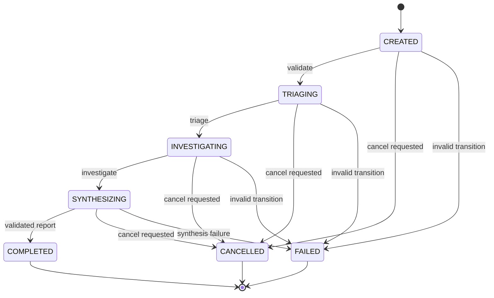

`workflow_state.py` owns transition legality. Completed, failed, and cancelled are terminal states.

### Implemented LangGraph sequence

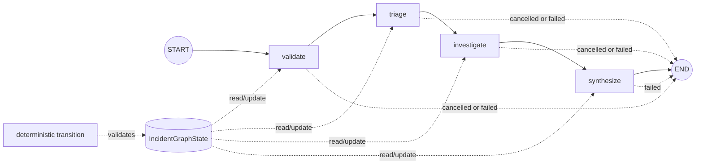

This is the current linear graph. Parallel specialist branches, reducers, and checkpoint persistence are deferred to later modules.

## Module 6 - Specialization and context engineering

### Goal
Create defensible Logs, Metrics, and Traces specialist boundaries without relying on persona prompts or shared conversation history.

### Design change
- Added `src/incidentlens/specialists.py` with versioned role contracts, isolated context, structured findings, and deterministic evidence-citation validation.
- Logs, Metrics, and Traces roles have distinct objectives, signal domains, tool policies, budgets, and stopping rules.
- `SpecialistContext` filters evidence by role signal type and rejects unexpected fields, keeping peer conclusions and evaluator-only data outside the initial context.
- The role contract lists future `search_logs`, `search_traces`, and `get_trace` capabilities, while the currently implemented runtime tool remains `query_metrics`.

### Diagram

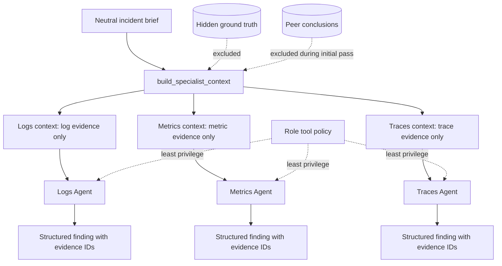

### Why this matters
Different names or personalities do not justify multiple agents. The boundary is useful because each specialist receives a different evidence domain and tool policy, while structured findings preserve evidence IDs for later aggregation and verification. This reduces context contamination and makes unauthorized access testable.

### Verification
`python -m pytest -q` passed 71 tests with 1 skipped. Tests cover role-specific tools, signal-domain filtering, extra-field rejection, unique evidence IDs, and unknown evidence citation rejection.

### Known limitations
The Logs and Traces backend tools are not implemented yet; their contracts are declared for the planned specialist surface only. Peer aggregation, specialist invocation through LangGraph, and role-confusion evaluation remain pending.

### Module 6 runtime specialist tools update
The previously declared Logs and Traces capabilities are now backed by recorded-fixture tools. `build_logs_registry` exposes only `search_logs`; `build_traces_registry` exposes only `search_traces` and `get_trace`; `build_metrics_registry` continues to expose only `query_metrics`. All three surfaces use the active agent-facing fixture, bounded typed arguments, UTC half-open windows, sanitized invalid-query results, and provider-neutral telemetry records. `get_trace` retrieves trace records by stable trace ID and preserves deterministic ordering.

### Module 6 runtime tool diagram

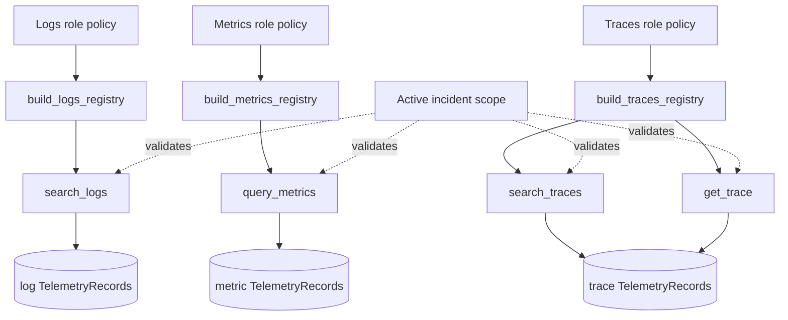

Verification: `python -m pytest -q` passed 76 tests with 1 skipped; Ruff check and format check passed. Role-confusion and missing-evidence cases, specialist model invocation, and final Module 6 review remain pending.

### Module 6 role-confusion validation update
Added parameterized role-confusion tests covering all three specialist contexts and runtime registries. Tests verify domain-only evidence, absence of peer conclusions and ground-truth terms, and rejection of cross-domain tool calls. The current role boundary is now enforced both in context construction and in separate runtime registries.

Verification: `python -m pytest -q` passed 81 tests with 1 skipped; Ruff check and format check passed. Final Module 6 review and missing-evidence behavior remain pending.

### Module 6 missing-evidence validation update
Specialist contexts may be empty when the assigned signal domain has no retrieved records. `SpecialistFinding` still requires at least one evidence ID, and `validate_finding_evidence` rejects invented or unavailable IDs. This forces the agent/application boundary to represent missing evidence as uncertainty or an open question rather than silently asserting that no signal existed.

Verification: `python -m pytest -q` passed 86 tests with 1 skipped; Ruff format check passed. Missing-evidence behavior is now covered for every specialist role.

### Module 6 completion update
- Status: Completed

Specialization is now enforced through distinct role contracts, signal-domain filtering, isolated contexts, and separate runtime registries. The design rejects persona-only agents and keeps peer findings out of initial specialist context. Findings require unique evidence IDs and deterministic availability validation before downstream synthesis.

The Logs, Metrics, and Traces boundaries are now implemented over recorded fixtures. Future modules will add specialist model invocation, aggregation, verification, and parallel execution while preserving these least-context and least-privilege boundaries.

## Module 7 - Coordination topologies and protocol design

### Goal
Coordinate independent specialist investigations through a centralized supervisor and explicit versioned messages rather than shared conversational history or decentralized peer handoffs.

### Design change
- Added `src/incidentlens/coordination.py` with `InvestigationTask` and `SpecialistFindingMessage` contracts.
- Task envelopes carry incident scope, specialist role, objective, time window, permitted tools and signals, evidence references, budgets, and output contract.
- Finding messages carry task and agent identity, claim type, confidence, evidence IDs, open questions, and limitations.
- `validate_finding_for_task` rejects stale, cross-incident, wrong-role, and out-of-scope evidence messages.
- `FindingInbox` handles exact retries idempotently and rejects conflicting duplicate IDs.

### Diagram

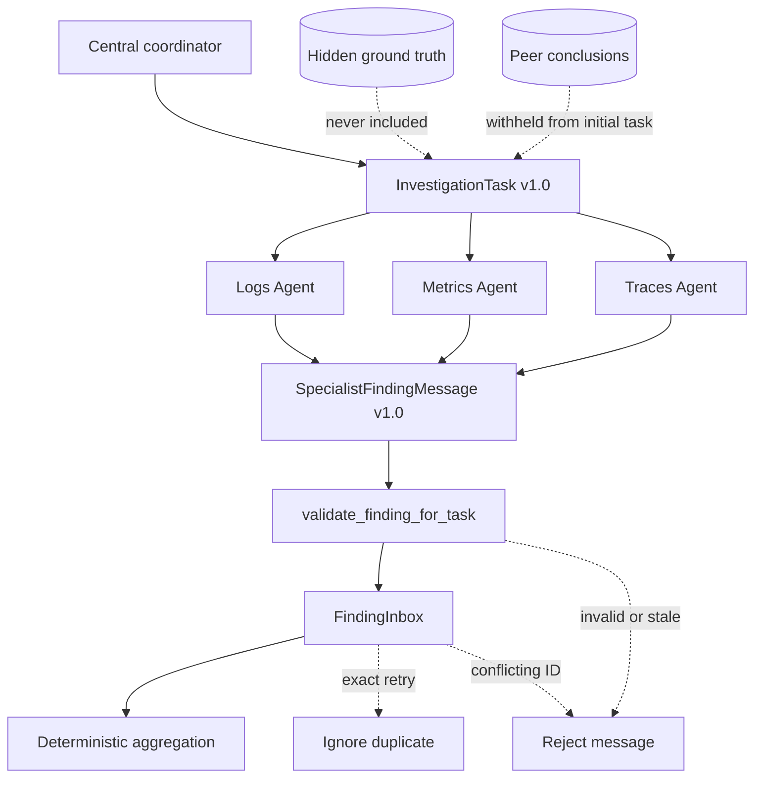

### Why this matters
The centralized coordinator owns delegation, validation, duplicate handling, aggregation, and lifecycle coordination. Specialists remain independently scoped, while explicit task and finding contracts make provenance, permissions, and failure handling auditable.

### Verification
`python -m pytest -q` passed 94 tests with 1 skipped; Ruff check and format check passed. Coordination tests cover valid messages, unsupported versions, extra fields, role mismatch, evidence scope, stale tasks, exact retries, and conflicting duplicates.

### Known limitations
Pattern comparison labs and runtime coordinator routing are not yet implemented. The current inbox is in-memory; durable artifacts and parallel execution are later modules.

### Module 7 coordinator and topology implementation update
Added deterministic `build_investigation_tasks`, `InvestigationCoordinator`, and topology labs for router, handoff, and supervisor-workers patterns. Task creation derives permissions, budgets, objectives, and signal scopes from the versioned specialist contracts rather than model text. Coordinator finding intake delegates to `FindingInbox`, so stale, incompatible, out-of-scope, and conflicting duplicate messages are rejected consistently.

The decision matrix records supervisor-workers as the initial IncidentLens topology. Router remains useful for narrow single-domain incidents; handoff and group-chat-like peer coordination remain less suitable for the core flow because they weaken centralized routing and increase duplicate or circular work risk.

Verification: `python -m pytest -q` passed 97 tests with 1 skipped; Ruff check and format check passed.

### Module 7 completion update
- Status: Completed

IncidentLens selects a centralized supervisor-workers topology. The coordinator creates versioned scoped tasks, dispatches independent specialists, validates returned findings against task ownership and evidence scope, deduplicates exact retries, rejects conflicting duplicates, and controls aggregation and later synthesis. Router and handoff remain documented pattern alternatives rather than unrestricted runtime choices.

The Module 7 coordination diagram and decision matrix are now part of the architecture record. Parallel execution and reducer semantics are intentionally implemented in Module 8, while persistence and checkpoint recovery remain later concerns.

### Module 8 bounded parallel execution increment
Added `src/incidentlens/parallel_investigation.py` with `run_branch` and `run_parallel`. The runner limits concurrent admission with `asyncio.Semaphore`, bounds each worker with `asyncio.wait_for`, converts timeout/failure/cancellation into structured `SpecialistBranchResult` values, validates returned finding messages, and sorts fan-in results by fixed specialist order rather than completion order. Sibling success is preserved when one branch fails.

### Module 8 parallel execution diagram

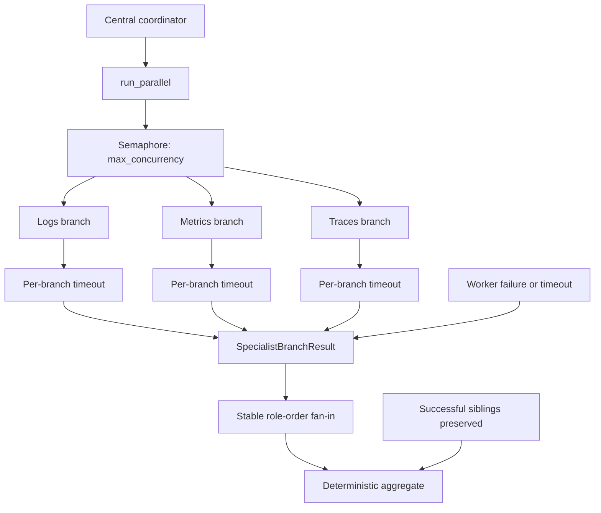

Verification: `python -m pytest -q` passed 102 tests with 1 skipped; Ruff check and format check passed. Global investigation deadlines, cancellation propagation across siblings, duplicate finding aggregation, and sequential-vs-concurrent latency comparison remain pending.

### Module 8 completion implementation update
`run_parallel` now creates bounded branch tasks, limits concurrent admission with a semaphore, applies per-branch deadlines, and optionally applies a global investigation deadline. When the global deadline expires, unfinished branches are cancelled and represented as structured results while completed siblings are preserved. `aggregate_findings` sends successful findings through `FindingInbox`, so exact duplicate worker results do not inflate evidence or confidence and invalid findings do not enter the aggregate.

### Module 8 timing and failure diagram

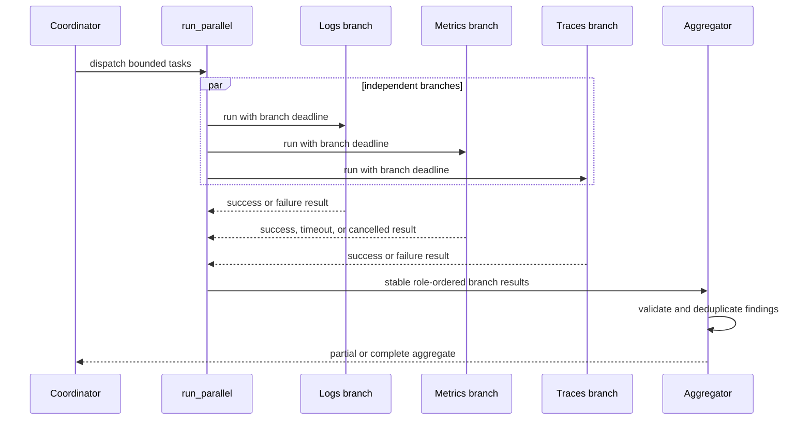

Verification: `python -m pytest -q` passed 105 tests with 1 skipped; Ruff check and format check passed. Final review remains the only Module 8 completion gate.

### Module 8 completion update
- Status: Completed

IncidentLens now supports bounded fan-out/fan-in execution. `run_parallel` owns concurrency admission, branch deadlines, global deadline cancellation, and stable role ordering. `aggregate_findings` uses the coordination inbox to preserve valid findings and suppress exact duplicates without allowing branch arrival order to affect interpretation.

A branch timeout or cancellation is an uncertainty-bearing result, not evidence that the signal was healthy or absent. The coordinator can continue to synthesis when successful sibling findings are sufficient for a valid partial or inconclusive report; unrecoverable workflow failures remain distinct.

### Module 9 - Memory, persistence, checkpoints, and artifacts
- Status: In Progress

#### Before this module
Workflow state and baseline reports existed, but state was not connected to a durable checkpoint/recovery boundary, and evidence/report persistence was not represented as a reusable typed artifact store.

#### What changed
Added `src/incidentlens/persistence.py` with provider-neutral, versioned `StoredArtifact` and `Checkpoint` contracts. `ArtifactStore` persists validated JSON artifacts with path-safe identities, atomic replacement, exact-duplicate idempotency, conflicting-duplicate rejection, corruption classification, and active-incident scope checks. `CheckpointStore` persists investigation snapshots and rejects unsupported state versions before restoration.

#### Diagram/Flow
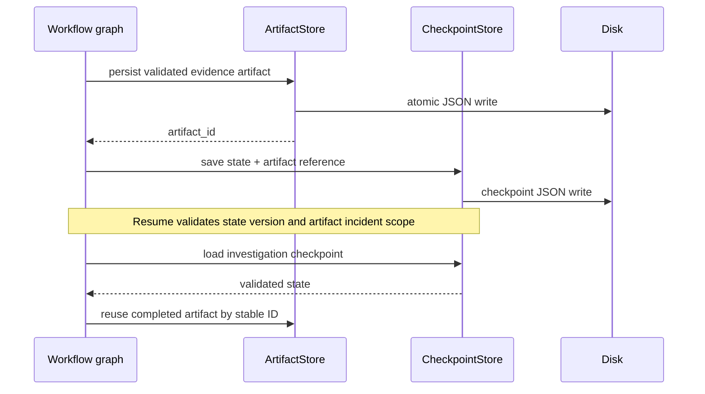

#### Why it changed
Recovery must distinguish validated durable work from work that was only observed in memory. Stable artifact identities close the crash window between artifact commit and checkpoint commit without duplicating evidence or repeating completed read work.

#### Alternatives considered
Copying raw telemetry into graph messages was rejected because it is large, lossy, and difficult to audit. Unrestricted cross-run memory is deferred because it introduces provenance, retention, privacy, staleness, and poisoning concerns.

#### Ownership and boundary decisions
The persistence layer owns serialization, integrity, scope, duplicate, and version checks. The workflow/orchestrator will own when a checkpoint is committed and which incomplete work may be retried. Models do not select artifact paths, incident scope, or checkpoint compatibility.

#### Verification and evidence
`tests/test_persistence.py` passed 8 tests. Full validation passed 113 tests with 1 live test skipped; Ruff check and format check passed. LangGraph integration and real interrupted-run recovery are unverified.

#### Known limitations after this module
The stores are filesystem-backed and are not yet integrated with `workflow_graph.py`. Checkpoint save/load does not yet reconcile artifact references or prevent duplicate workflow resumes.

#### Next design step
Integrate `CheckpointStore` with stable investigation/thread IDs in the graph, persist evidence/report references in graph state, and validate restart, stale-reference, duplicate-resume, and migration behavior.
#### Module 9 checkpoint integration update
Integrated the optional LangGraph checkpointer into `build_incident_graph` with controlled interruption and stable `thread_id` resume. Synthesis now stores a versioned report artifact through `ArtifactStore` and records its ID in `IncidentGraphState.artifact_references`. Focused tests verify pause, resume, and report artifact retrieval. Stale-reference reconciliation, duplicate resume handling, and retention limits remain unverified.
#### Module 9 persistence safeguard update
Added unavailable-artifact errors, reference validation against the active incident, configurable byte/count retention limits, atomic checkpoint writes, and durable evidence artifacts alongside reports. Duplicate resume now reuses versioned artifact IDs and preserves a single artifact per logical evidence/report object. Full validation passed 118 tests with 1 live test skipped; Ruff checks passed. Final conceptual review remains pending.
### Module 9 completion update
- Status: Completed

Module 9 now has durable, versioned artifact and checkpoint foundations. Graph resume uses stable LangGraph thread IDs; synthesis stores evidence and report artifacts before returning references in graph state; duplicate resume reuses stable artifact IDs. Artifact loading enforces availability, incident scope, schema integrity, size/count limits, and checkpoint reference validation. Checkpoint loading enforces JSON/schema validity and supported state versions before restoration.

Verification: `python -m pytest -q` passed 119 tests with 1 live test skipped; Ruff check and format check passed. The implementation remains filesystem-backed, and long-term memory plus a separate production recovery service are deferred.
### Module 10 - Planning, adaptive routing, budgets, and termination
- Status: In Progress

#### Before this module
IncidentLens had deterministic specialist task creation, bounded parallel execution, and lifecycle ownership, but no complexity-aware planning or controlled follow-up round.

#### What changed
Module 10 orientation establishes a hybrid design: deterministic baseline decomposition plus at most one model-proposed follow-up round. The coordinator validates task scope, duplicates, dependencies, permissions, and remaining budgets before dispatch. The model cannot mutate lifecycle state or terminate the workflow directly.

#### Diagram/Flow
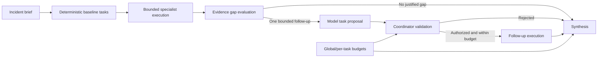

#### Why it changed
Known safety rules and budget limits should remain deterministic, while evidence-dependent follow-up decisions benefit from model reasoning. A hybrid boundary preserves adaptation without allowing plans to bypass authorization or termination controls.

#### Ownership and boundary decisions
The model proposes tasks or evidence gaps. The coordinator owns plan validation, task creation, duplicate/cycle checks, budget enforcement, dispatch, and termination. The lifecycle transition layer remains the only status authority.

#### Known limitations after this module
Implementation and validation are pending. Complexity scoring, follow-up contracts, and termination policy are currently proposed.

#### Next design step
Add typed bounded plan proposals and deterministic validation, then test under-delegation, excessive fan-out, duplicate/circular tasks, impossible evidence requests, and budget exhaustion.
#### Module 10 follow-up scheduling implementation update
Added coordinator-owned conversion from `FollowUpProposal` to `InvestigationTask`. Role contracts supply permissions and bounded budgets; the finding inbox registers accepted follow-up tasks; canonical coordinator fingerprints prevent duplicate scheduling; and active incident scope is checked before creation. Verification passed 125 tests with 1 live test skipped and Ruff checks. Complexity policy, global budget ledger, and final termination routing remain proposed.
#### Module 10 implementation update
Added deterministic complexity classification and baseline role selection, a global model/tool budget ledger, explicit termination decisions, and bounded follow-up scheduling. Model proposals remain untrusted; the coordinator validates grounding, role, scope, duplicate identity, follow-up limits, deadline, and budgets before deriving a task from role policy. Verification passed 130 tests with 1 live test skipped and Ruff checks.
### Module 10 completion update
- Status: Completed

Module 10 established the hybrid planning boundary: deterministic complexity-based baseline selection, model-proposed evidence-gap follow-ups, coordinator validation, role-derived permissions, global budget accounting, and explicit termination reasons. A simple incident can select only the metrics specialist; broader incidents can select all available specialists. Budget exhaustion and follow-up limits produce partial/inconclusive reporting rather than unsupported conclusions.

Verification: final conceptual review and failure analysis passed; `python -m pytest -q` passed 130 tests with 1 live test skipped; Ruff check and format check passed. Follow-up task dependencies remain intentionally flat and circular delegation is prevented by the centralized topology.
### Module 11 - Runbook RAG and change intelligence
- Status: In Progress

#### Before this module
IncidentLens had telemetry evidence tools and specialist findings, but no versioned operational-knowledge corpus or bounded deployment/change intelligence path.

#### What changed
Module 11 orientation separates retrieved runbook guidance, change-event observations, and current-incident telemetry. Proposed Runbook and Change Agents will use deterministic service/version/validity filters and exact citations; retrieved text remains untrusted data and cannot change workflow policy.

#### Diagram/Flow
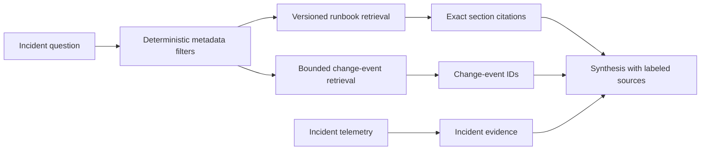

#### Why it changed
Runbooks explain possible procedures and changes explain historical events; neither should be conflated with telemetry observations or treated as automatic causal proof.

#### Ownership and boundary decisions
The retrieval tools own filtering, ranking bounds, provenance, and citation references. Agents may request retrieval; deterministic code controls scope, versions, validity windows, and tool permissions. Synthesis must distinguish guidance, observation, inference, and hypothesis.

#### Known limitations after this module
Implementation and retrieval evaluation are pending. The corpus will initially be synthetic and small; vector retrieval and live change backends are not yet present.

#### Next design step
Define versioned runbook-section and change-event contracts, add bounded retrieval tools, and test stale, contradictory, missing, irrelevant, and malicious content.
#### Module 11 retrieval contract implementation update
Added provider-neutral `RunbookSection`, `RunbookCitation`, and `ChangeEvent` contracts in `src/incidentlens/retrieval.py`. Deterministic filtering enforces service, environment, active status, UTC-aware validity, and half-open incident-time windows. Verification passed 138 tests with 1 live test skipped and Ruff checks. Corpus loading, ranking, agent wiring, and retrieval evaluation remain pending.
#### Module 11 corpus and retrieval implementation update
Added `RunbookCorpus` JSON loading and deterministic lexical retrieval. Metadata and validity filters run before ranking; result limits are bounded; ties are stable; and outputs preserve exact document/section citations. Runbook retrieval remains guidance, not telemetry evidence. Verification passed 142 tests with 1 live test skipped and Ruff checks.
#### Module 11 agent interface implementation update
Added isolated read-only `RunbookAgent` and `ChangeAgent` interfaces. The Runbook Agent can call only `retrieve_runbook` and returns `RunbookCitation` objects; the Change Agent can call only `query_changes` and returns bounded `ChangeEvent` objects. Their query contracts and signal scopes are separate, and change results are UTC-windowed and deterministically ordered. Verification passed 145 tests with 1 live test skipped and Ruff checks.
#### Module 11 adversarial retrieval update
Added tests for irrelevant, contradictory, stale, missing, and malicious runbook content. The retriever preserves contradictory sources as separate citations, returns no evidence for missing matches, filters stale sections deterministically, and treats malicious text as inert content without expanding agent permissions. Verification passed 149 tests with 1 live test skipped and Ruff checks.
#### Module 11 retrieval evaluation update
Added deterministic retrieval metrics for citation precision, recall, hit rate, and reciprocal rank. Metrics compare retrieved section IDs with labeled relevant IDs and intentionally stop at retrieval quality; final diagnosis correctness remains a separate evaluation layer. Verification passed 153 tests with 1 live test skipped and Ruff checks.
#### Module 11 change correlation update
Added deterministic temporal correlation for change events with bounded pre-incident proximity, before/during relations, stable ordering, and an explicit non-causal result contract. Deployment/configuration timing can be surfaced as a candidate explanation, but no correlation result is accepted as causal proof. Verification passed 155 tests with 1 live test skipped and Ruff checks.
### Module 11 completion update
- Status: Completed

Module 11 established separate read-only Runbook and Change Agents. Versioned runbook sections are filtered by deterministic service/environment/status/validity metadata before lexical ranking and returned with exact citations. Change events are bounded by UTC windows and surfaced as temporal correlations without causal promotion. Contradictory and malicious retrieved content remains separate, auditable, untrusted data.

Verification: final conceptual review and failure analysis passed; `python -m pytest -q` passed 155 tests with 1 live test skipped; Ruff check and format check passed. Semantic/vector retrieval and full diagnosis evaluation remain deferred.
### Module 12 - Hypothesis formation, critique, and calibrated confidence
- Status: In Progress

#### Before this module
IncidentLens produced evidence-linked reports and specialist findings, but did not yet have separate hypothesis-generation and verification contracts or explicit abstention semantics.

#### What changed
Module 12 orientation establishes a generator/verifier boundary. The Hypothesis Agent proposes ranked candidates with supporting, contradicting, and missing evidence. The Verifier Agent receives structured claims and evidence references independently, checks grounding and counter-evidence, and may downgrade, reject, or mark `insufficient_evidence`.

#### Diagram/Flow
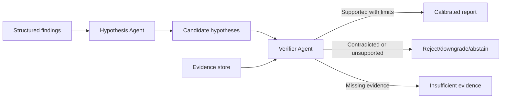

#### Why it changed
A coherent explanation or repeated agent agreement is not proof. A separate verifier creates an explicit boundary for counter-evidence, causal gaps, and uncertainty.

#### Ownership and boundary decisions
The model proposes hypotheses and verification observations. Deterministic code validates evidence IDs, enforces critique rounds, preserves contradictions, and controls report acceptance. The verifier cannot invent evidence or promote unsupported claims.

#### Known limitations after this module
Implementation and evaluation are pending. Confidence calibration will initially use structured rules and synthetic scenarios rather than statistical calibration over a large incident set.

#### Next design step
Define hypothesis/verifier contracts with evidence obligations, add bounded verification, and test unsupported, contradictory, incomplete, and distractor-heavy scenarios.
### Module 12 — Hypothesis formation, contradiction handling, and calibrated confidence
- Status: In Progress

#### Before this module
Hypotheses were represented in the general report contract, but there was no dedicated evidence-table contract or deterministic verification boundary for candidate causes.

#### What changed
Added `src/incidentlens/hypotheses.py` with structured hypothesis/evidence contracts, evidence-ID grounding, explicit abstention semantics, and deterministic verification outcomes. Added focused tests in `tests/test_hypotheses.py`.

#### Why it changed
A schema-valid causal claim can still cite nonexistent evidence, ignore contradictory observations, or confuse unavailable evidence with normal behavior. Verification needs to inspect claims and evidence references before synthesis.

#### Ownership and boundary decisions
The model may propose a candidate hypothesis. Deterministic application code validates evidence IDs and classifies the candidate as supported, low-confidence, contradicted, or insufficient-evidence. Missing evidence never becomes evidence of absence.

#### Verification and evidence
`python -m pytest tests\\test_hypotheses.py -q` -> 7 passed. Full validation -> 162 passed, 1 skipped. Ruff check and format check passed.

#### Known limitations after this module
The verifier is currently a deterministic contract-level check, not yet a separate model-driven Verifier Agent with bounded critique rounds or alternative-hypothesis generation.

#### Next design step
Add the isolated Verifier Agent contract, fixed critique budget, and tests for unsupported causes, conflicting specialist findings, missing signals, and deceptive distractors.
### Module 12 verifier-boundary follow-up
- Status: In Progress

#### What changed
Added `VerifierContext`, `VerifierRunResult`, and `VerifierAgent` to `src/incidentlens/hypotheses.py`. The verifier receives an isolated structured context, validates candidate citations against available evidence, and enforces `max_critique_rounds` before review.

#### Ownership and boundary decisions
The model may propose critiques, but the deterministic verifier boundary owns context construction, evidence grounding, hypothesis lookup, and critique-round limits. Peer conclusions and evaluator-only fields are rejected by the context schema rather than trusted from conversation text.

#### Verification and evidence
`python -m pytest tests\\test_hypotheses.py -q` -> 11 passed. Full validation -> 166 passed, 1 skipped. Ruff check and format check passed.

#### Known limitations after this module
The current verifier review function is deterministic and contract-level. A model-backed critique adapter and fixed multi-round comparison remain to be added and evaluated.
### Module 12 model-backed critique follow-up
- Status: In Progress

#### What changed
Added `ModelCritiqueProposal` and `VerifierAgent.review_with_model(...)` in `src/incidentlens/hypotheses.py`. The model receives a compact verifier context and proposes supporting, contradicting, and missing evidence. The application validates and deterministically classifies that proposal.

#### Ownership and boundary decisions
The model proposes critique content only. It cannot select another hypothesis, cite unavailable evidence, exceed the critique-round limit, or directly set the final confidence/status. Provider-specific model clients remain outside this provider-neutral contract.

#### Failure and security implications
Malformed proposals, unknown evidence IDs, hypothesis-scope mismatches, and exhausted rounds are rejected before the result is accepted. A model cannot convert a missing signal into a negative observation or promote temporal correlation into causation.

#### Verification and evidence
`python -m pytest -q` -> 169 passed, 1 skipped. Ruff check and format check passed.

#### Known limitations after this module
The current model callback is tested with a fake provider. Live Gemini verifier prompting and multi-round quality evaluation remain unverified.
### Module 12 final review and completion
- Status: Completed

#### Verification and evidence
The learner completed the conceptual review and deceptive deployment-correlation exercise. The implementation gate remains supported by `169 passed, 1 skipped`, Ruff check passed, and format check passed.

#### Known limitations after this module
The verifier boundary is implemented and tested with a fake model callback. Live provider prompting, calibration against human judgments, and multi-round critique quality are deferred to evaluation work.

#### Next design step
Add human approval and authorization boundaries before any simulated remediation in Module 13.
### Module 13 — Human oversight, authorization, and safe actions
- Status: In Progress

#### Before this module
IncidentLens core investigation paths are read-only and can produce hypotheses or plans, but no approval-bound action contract exists.

#### What changed
Module 13 orientation establishes separate authentication, authorization, and human-approval controls. Any future simulated remediation must be bound to exact action arguments and revalidated server-side before execution.

#### Ownership and boundary decisions
The model may propose an action. Deterministic policy code decides whether the capability is allowed. An authorized human approves the exact action. The backend owns final approval validation, idempotency, audit recording, and execution.

#### Next design step
Define action-plan, approval, authorization, and audit-event contracts before adding an interrupt/resume path.
### Module 13 approval-contract implementation
- Status: In Progress

#### What changed
Added `src/incidentlens/approval.py` with provider-neutral `ActionPlan`, `Approval`, `AuditEvent`, deterministic action fingerprinting, approval validation, and one-time approval consumption.

#### Ownership and boundary decisions
The model may propose an `ActionPlan`, but deterministic application code computes the fingerprint and validates authorization, expiry, exact action identity, evidence justification, policy version, rejection history, and duplicate execution. Human approval is represented as a separate persisted contract.

#### Failure and security implications
Changing action arguments or evidence invalidates approval. Rejected fingerprints cannot be reused. Unauthorized, expired, mismatched, and already-consumed actions are rejected with sanitized classifications.

#### Verification and evidence
`python -m pytest tests\\test_approval.py -q` -> 9 passed. Full validation -> 178 passed, 1 skipped. Ruff check and format check passed.

#### Next design step
Add a durable approval interrupt/resume path and audit-event persistence, then verify stale approval and duplicate resume behavior.
### Module 13 durable approval interrupt/resume
- Status: In Progress

#### What changed
Extended `src/incidentlens/approval.py` with `ApprovalRecord` and `ApprovalStore`. Approval requests persist before the workflow pauses. Resume validates approval and records an `executing` marker before invoking the simulated executor.

#### Ownership and boundary decisions
The durable store owns approval persistence, audit-event recording, resume status, and at-most-once execution protection. A resumed workflow never trusts model state or a frontend approval alone.

#### Failure and security implications
A missing approval returns `awaiting_approval`. A rejected fingerprint cannot be approved later. A crash or failure after the `executing` marker returns `indeterminate` on resume rather than repeating a potentially completed side effect. Raw executor exceptions are not persisted.

#### Verification and evidence
`python -m pytest tests\\test_approval_store.py -q` -> 8 passed. Full validation -> 186 passed, 1 skipped. Ruff check and format check passed.

#### Known limitations after this module
The store is a local file-backed implementation and is not yet integrated with the main LangGraph lifecycle or a transactional external action executor.

#### Next design step
Complete the Module 13 conceptual review and connect the approval boundary to workflow interruption without enabling real remediation.
### Module 13 final review and completion
- Status: Completed

#### Verification and evidence
The learner passed the final conceptual review and crash/recovery analysis. Full validation remains `186 passed, 1 skipped`; Ruff check and format check passed.

#### Known limitations after this module
The local store returns `indeterminate` for uncertain execution and does not yet reconcile with an external action system. Real remediation remains out of scope; the executor is simulated.

#### Next design step
Threat-model retries, prompt injection, tool-result poisoning, cross-incident authorization, and safe logging in Module 14.

### Module 14 telemetry error mapping increment
- Status: In Progress

#### Design change
Telemetry query errors now optionally carry the shared provider-neutral `IncidentError`. Timeout and dependency classifications map to stable IncidentLens categories, while cross-incident fixture requests remain `invalid_query` results with a terminal `incident_scope_violation` classification.

#### Verification
Telemetry-focused validation passed 26 tests; full validation passed 197 tests with one live test skipped; Ruff and formatting checks passed.

#### Known limitations after this increment
Raw exception redaction, audit-safe persistence, and live backend timeout injection remain unimplemented. Existing telemetry results retain their lower-level classifications for compatibility.

#### Next design step
Add deterministic redaction and safe logging before errors or diagnostic context cross persistence, audit, or user-facing boundaries.

### Module 14 redaction and safe-error increment
- Status: In Progress

#### Design change
Added bounded text sanitization at the shared error boundary. Common database connection strings, secret/token/API-key/authorization assignments, and customer identifiers are replaced before user-facing error construction. Telemetry error mapping now sanitizes backend messages before creating `IncidentError`.

#### Verification
Focused redaction, telemetry, and approval validation passed; full validation passed 199 tests with one live test skipped; Ruff and formatting checks passed.

#### Known limitations after this increment
The current sanitizer is text-oriented and pattern-based. It does not yet recursively redact arbitrary structured telemetry or diagnostic payloads, and no centralized logging sink exists.

#### Next design step
Add field-aware redaction tests for nested payloads, headers, exception chains, and audit serialization before introducing broader diagnostic logging.

### Module 14 field-aware redaction validation
- Status: In Progress

#### Design change
The error boundary now provides recursive structured-data sanitization and chained-exception sanitization for diagnostic/audit copies. Sensitive mapping keys and text patterns are redacted while ordinary fields remain available for debugging. Executable action plans and fingerprints are not rewritten by the sanitizer.

#### Verification
Focused redaction and audit tests passed 18 tests; full validation passed 202 tests with one live test skipped; Ruff and formatting checks passed.

#### Known limitations after this increment
The sanitizer is still pattern-based and is not a substitute for field-level authorization or a centralized secure diagnostic sink.

#### Next design step
Add controlled adversarial tests for prompt injection, hidden-ground-truth leakage, and retry storms.

### Module 14 adversarial validation
- Status: In Progress

#### Verification
Runbook retrieval tests confirm injection-like content remains inert data with unchanged tool permissions. Fixture projection tests confirm hidden ground truth is excluded from agent context. Retry-storm tests bound 20 failing investigations to 40 total model attempts under a two-attempt per-run policy. Full validation passed 203 tests with one live test skipped.

#### Known limitations after this increment
The retry bound is currently per agent run; a coordinator-wide shared retry budget and circuit breaker for live dependencies are not yet integrated.

#### Next design step
Add controlled partial-backend outage and circuit-breaker recovery tests, preserving useful evidence from healthy dependencies.

### Module 14 circuit breaker and partial-backend recovery
- Status: In Progress

#### Design change
Added a deterministic `CircuitBreaker` with closed, open, and half-open states and injected-clock recovery tests. Parallel investigation accepts dependency-specific breakers; an open specialist dependency fails fast without preventing healthy sibling branches from completing.

#### Verification
Circuit-breaker and partial-backend focused validation passed 12 tests; full validation passed 207 tests with one live test skipped; Ruff and formatting checks passed.

#### Known limitations after this increment
Breaker state is currently passed per specialist role rather than owned by a coordinator registry keyed by backend, tenant, and environment. User-visible partial status remains represented at branch-result level.

#### Next design step
Connect breaker state to coordinator policy, failure-matrix classifications, and explicit user-visible partial/inconclusive report status.

### Module 14 coordinator-owned circuit-breaker registry
- Status: In Progress

#### Design change
Circuit state is now owned by a coordinator-provided `CircuitBreakerRegistry` keyed by backend, tenant, and environment. Specialist branches resolve their backend breaker from task scope, so one tenant or environment cannot open the circuit for another while repeated failures share protection within the correct scope.

#### Verification
Registry and parallel-investigation validation passed 36 focused tests; full validation passed 209 tests with one live test skipped; Ruff and formatting checks passed.

#### Known limitations after this increment
Branch results expose dependency failure, but the coordinator has not yet promoted circuit state into a unified failure-matrix status or explicit user-facing partial/inconclusive report.

#### Next design step
Connect circuit outcomes to coordinator error classifications, partial report status, and uncertainty-aware synthesis.

### Module 14 coverage-status propagation
- Status: In Progress

#### Design change
Parallel aggregation now produces deterministic coverage status. Complete specialist coverage keeps a completed report; mixed healthy/unavailable branches force `inconclusive` and annotate the summary; absence of all successful branches produces `failed`. This prevents a model-generated completed status from hiding a dependency evidence gap.

#### Verification
Coverage and workflow-focused validation passed 34 tests; full validation passed 211 tests with one live test skipped; Ruff and formatting checks passed.

#### Known limitations after this increment
The coverage helper is implemented at the parallel aggregation boundary but is not yet wired into the main LangGraph report-synthesis node or a unified failure matrix.

#### Next design step
Connect coverage status and circuit classifications to the main coordinator/report acceptance path.

### Module 14 main workflow coverage integration
- Status: In Progress

#### Design change
Specialist branch results are now carried in `IncidentGraphState` through an injected investigation runner. The LangGraph synthesis node applies coverage status before persisting evidence/report artifacts and before selecting the lifecycle terminal state. Partial specialist availability produces an `inconclusive` report; zero successful branches produce `failed`.

#### Verification
Workflow coverage integration passed focused workflow tests; full validation passed 213 tests with one live test skipped; Ruff and formatting checks passed.

#### Known limitations after this increment
The investigation runner is injected for reproducible integration tests; production coordinator wiring and a complete failure matrix across model, telemetry, persistence, and authorization remain to be unified.

#### Next design step
Complete the Module 14 reliability/security review, then integrate the remaining failure classifications into one coordinator policy.

### Module 14 final review and completion
- Status: Completed

#### Goal
Make dependency failure and adversarial behavior explicit at deterministic boundaries so IncidentLens never converts unavailable evidence into negative evidence or unsupported causal certainty.

#### Design change
The main workflow now carries specialist branch results into graph state and applies deterministic coverage validation at the synthesis boundary. Mixed specialist outcomes preserve successful evidence but force an `inconclusive` report with an explicit limitation; zero successful branches produce a failed lifecycle because no grounded report can be produced. This is the implemented boundary for the circuit-open Metrics case: `OPEN` means no query was performed and the report may not claim resource saturation as established causation.

#### Verification
Final conceptual review, debugging task, and failure-matrix exercise passed. Full validation: `python -m pytest -q` -> 213 passed, 1 skipped. `python -m ruff check .` and `python -m ruff format --check .` passed.

#### Known limitations after this module
The workflow runner is injectable for deterministic tests, while production dependency wiring and a single coordinator-wide failure matrix remain future work. Circuit-breaker, error-contract, authorization, redaction, and coverage behaviors are implemented as separate boundaries and should be unified as live integrations are added.

#### Diagram/Flow
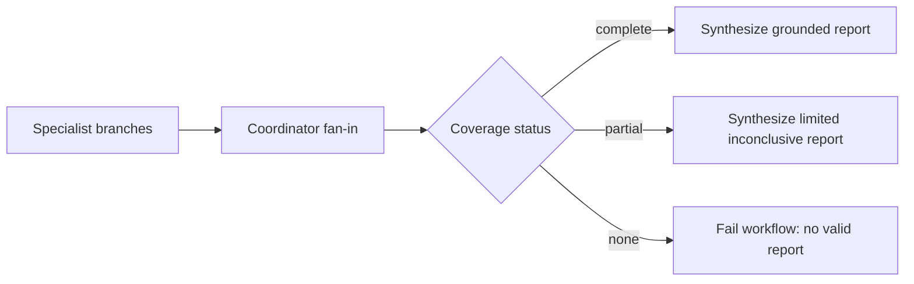

#### Next design step
Begin Module 15: define evaluation dimensions and baselines, then design ablations that test whether each specialist and resilience boundary improves grounded incident outcomes.

### Pre-Module 15 integration gap closure
- Status: In Progress

#### Design change
Closed several boundary gaps identified by the repository-wide review. The model loop now accepts a shared coordinator budget and consumes it before every model invocation, including retries. Retry jitter can be injected without weakening the maximum delay. Specialist branch results preserve structured `IncidentError` metadata for circuit-open, timeout, and sanitized dependency failures. Checkpoints validate both application state version and tool-contract version before resume, with a safe recovery mapping for incompatible contracts. Specialist role registries now derive directly from the role allowlists and fixture backend.

#### Ownership and boundary decisions
The coordinator-owned budget remains the authority that can prevent an adapter invocation. The retry layer may classify and schedule a permitted retry, but it cannot bypass the budget. The parallel coordinator preserves dependency error metadata rather than reducing it to empty findings. Recovery rejects incompatible tool contracts before any model or tool node executes.

#### Verification and evidence
Edited source and test files compile successfully with the configured Python interpreter; `git diff --check` passed. Full pytest and Ruff checks are currently unverified because the active shell lacks those installed packages. New tests cover budget refusal, role-registry allowlists, structured circuit-open results, and unsupported tool-contract recovery.

#### Known limitations after this increment
The main graph still supports injected producers for deterministic tests, but it now also accepts a graph-facing `CoordinatorRuntime` that composes bounded parallel specialist execution. The full model-backed specialist worker and mandatory model-driven verifier remain evaluation targets; deterministic report acceptance now downgrades explicit unresolved evidence requirements before lifecycle completion.

#### Next design step
Connect the runtime to model-backed specialist workers and the verifier, then instrument the composed path for Module 15 evaluation and ablation.

### Pre-Module 15 coordinator composition completion
- Status: Completed

#### Design change
Completed the remaining pre-evaluation runtime seams. Shared budgets now cover both model attempts and tool executions. Workflow state preserves sanitized structured failure details. `specialist_runtime.py` provides the bounded adapter from role-specific model clients and registries to coordinator findings, while `CoordinatorRuntime` performs scope-checked parallel fan-out/fan-in. `change_tools.py` adds a bounded, incident-scoped `list_changes` capability, backed by reproducible change and runbook fixtures.

#### Failure and security implications
Budget exhaustion prevents the corresponding invocation before execution. Specialist reports without evidence-linked hypotheses do not become coordinator findings. Cross-incident change requests are rejected by the tool handler. Checkpoint files missing a tool-contract version are treated as legacy v1 and rejected by default rather than silently upgraded.

#### Verification and evidence
Added tests for tool budgets, structured workflow errors, coordinator composition, role registries, checkpoint contract rejection, and change-tool scope/window validation. Edited Python files compile successfully and `git diff --check` passes; full pytest/Ruff execution remains pending until dependencies are installed in the active environment.

#### Known limitations after this module
The model-backed worker is provider-neutral and requires caller-supplied role adapters. Deterministic report acceptance is mandatory; model-backed verifier quality comparison is an evaluation target for Module 15. FastAPI/live telemetry remain Module 16.

### Module 15 - Evaluation harness foundation
- Status: In Progress

#### Goal
Evaluate IncidentLens outcomes and execution variants without leaking evaluator-only ground truth into agent-visible context.

#### Design change
Added `src/incidentlens/evaluation.py` with separate `EvaluationScenario` and `AgentScenarioView` contracts, development/held-out split validation, deterministic report scoring, aggregate metrics, and a pluggable `VariantRunner`. Added `fixtures/evaluation/scenarios.json` with development and held-out cases. Fixture loading validates that the manifest incident ID matches the evaluator scenario ID before projecting safe fields to an agent.

#### Diagram/Flow
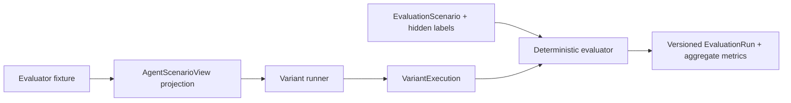

#### Why this matters
The evaluator can check citation existence, grounding, root-cause match, abstention, and efficiency while the agent receives only legitimate incident context. A held-out split provides a test of generalization after tuning development scenarios. Aggregate metrics make quality and cost trade-offs visible across deterministic, single-agent, full multi-agent, and no-verifier variants.

#### Verification
Added `tests/test_evaluation.py` coverage for hidden-label exclusion, held-out deterministic execution, aggregate calculations, configuration consistency, and fixture identity mismatch. Edited Python files compile successfully with the configured interpreter and `git diff --check` passes. Full pytest/Ruff execution is unverified because the active shell lacks those packages.

#### Known limitations after this increment
The harness accepts named runner adapters, persists comparable results, calculates aligned variant deltas, supports fresh repeated development trials, exposes a held-out-only final entry point, and records automated-versus-human judgment disagreements. The deterministic baseline, single-agent adapter, coordinator-backed verifier-enabled multi-agent path, and explicit no-verifier ablation are connected. The frozen deterministic held-out artifact is persisted at `artifacts/evaluation/held-out-final.json`; its one-scenario result is not evidence of broad generalization. A real human review sample, model-backed verifier critique, cost estimation, and graph-wide observability remain future Module 15 increments.

#### Next design step
Connect the deterministic workflow runner, add trajectory invariants, and persist comparable variant results.

### Module 15 offline comparison and live-failure accounting
- Status: In Progress

#### Goal
Separate architecture/evaluator validation from provider quota and network instability, while ensuring failed model executions cannot inflate quality metrics.

#### Design change
Added `OfflineEvaluationModel` and `--offline` to `scripts/run_development_comparison.py`. The scripted model reads only safe projected telemetry, produces structured reports, and supports all four variants without Gemini calls. The model adapter suppresses raw provider exception chaining, and evaluation scoring treats `failed` reports as neither grounded nor successful abstentions.

#### Diagram/Flow
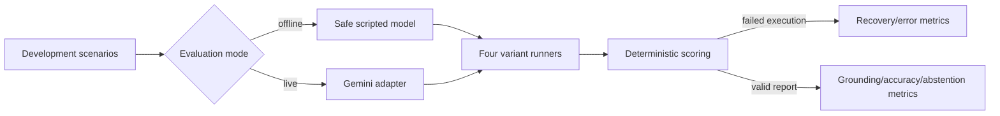

#### Why this matters
Provider failure is an execution/recovery result, not evidence that an architecture produces unsupported conclusions. The offline mode supplies a controlled regression signal for fan-out, verifier ablation wiring, persistence, and aggregation, while live runs remain necessary for real model quality.

#### Verification and evidence
`python -m py_compile` and `git diff --check` passed. The dependency-enabled offline three-trial comparison completed all variants with recovery and trajectory success of 1.0; grounded rate and root-cause accuracy were 1.0 for every variant. The live Gemini three-trial run recorded multi-agent recovery 0.0 and single-agent recovery 0.33 because of provider failures, so it is retained only as resilience evidence.

#### Known limitations after this increment
The scripted model is deterministic and intentionally does not measure semantic model reasoning, realistic tool selection, token use, or verifier value. Human calibration remains one reviewed held-out sample. A healthy multi-trial Gemini run and a larger held-out set are still required before making generalization or verifier-effect claims.

#### Next design step
Complete the Module 15 evidence gate with a larger independent review sample, a healthy live ablation when provider capacity permits, and explicit cost/token instrumentation.

### Module 15 live evaluation controls
- Status: In Progress

#### Design change
The development comparison retains provider-neutral `--variant` filtering and deterministic `--offline` mode while using the Gemini adapter directly. Live provider failures remain separate from report-quality metrics.

#### Verification and known limitations
Offline comparisons remain the reproducible evidence for evaluation plumbing. Live Gemini quality and verifier-effect claims require healthy repeated trials, held-out scenarios, and explicit token/cost instrumentation.
