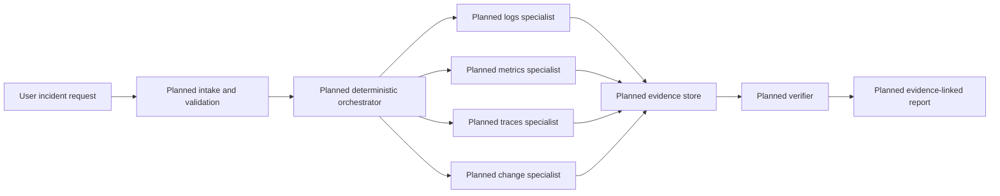

# IncidentLens Design Evolution

## Purpose
IncidentLens is a learning project for designing, implementing, evaluating, and explaining a multi-agent incident investigation assistant. It will analyze synthetic or public telemetry and produce evidence-linked incident reports while keeping remediation read-only or simulated behind human approval.

## Design principles
- Start with deterministic behavior and a single-agent baseline before adding multiple agents.
- Add an agent only when specialization is justified by different context, tools, permissions, or reasoning responsibility.
- Treat telemetry, runbooks, model output, and retrieved content as untrusted until validated.
- Preserve evidence provenance through stable IDs rather than relying on agent prose.
- Keep hidden ground truth outside every agent-visible path.
- Prefer explicit state, bounded tools, and deterministic guards around probabilistic model calls.
- Keep lifecycle transitions, authorization, validation, budgets, and human approval in deterministic application code.

## Current architecture snapshot
- Roadmap module and implementation status: Module 2 completed. A local, testable single-agent loop boundary exists with a scripted model client, Pydantic contracts, a fixture-backed read-only tool, and focused tests. The Gemini/LangChain adapter boundary is implemented and tested offline; live reachability and signed-message replay were exercised, but live final-report parsing remains unsuccessful.

### Component and agent summary
Implemented Module 2 components:
- `src/incidentlens/contracts.py`: Pydantic contracts for incidents, evidence, hypotheses, reports, and model responses.
- `src/incidentlens/tools.py`: fixture-backed read-only tool and tool registry.
- `src/incidentlens/agent_loop.py`: deterministic loop runner that calls a model client, validates model responses, executes validated tools, stores observations, propagates permitted tool execution failures, and enforces max-step termination.
- `src/incidentlens/config.py`: settings boundary for Gemini model name, API key, max steps, retry count, and retry timing.
- `fixtures/incidents/payment_latency.json`: small synthetic fixture.
- `tests/test_agent_loop.py`: focused tests for happy path, unknown tools, malformed args, max-step termination, and invalid evidence references, malformed model output, and permitted tool execution errors.

Proposed components:
- Incident intake and lifecycle validator
- Deterministic orchestrator/coordinator
- Read-only telemetry tools
- Specialist investigators for logs, metrics, traces, and deployment/change evidence
- Evidence store
- Verification component
- Evidence-linked report writer

### Agent responsibilities, context, tools, and permissions
No live LLM agent is implemented yet. The current model boundary is a `ModelClient` protocol used by tests with a scripted model. Future Gemini integration must implement this boundary without giving the model direct tool execution or permission authority.

Proposed boundaries:
- Logs specialist: log evidence only unless explicitly delegated cross-signal context.
- Metrics specialist: metric evidence only unless explicitly delegated cross-signal context.
- Traces specialist: trace/span evidence only unless explicitly delegated cross-signal context.
- Change specialist: deployment and configuration events.
- Verification component: checks hypotheses against evidence and searches for contradictions, rather than merely agreeing or disagreeing.
- Synthesis component: writes report claims only from structured findings and evidence IDs.

### State and artifact ownership
Incident lifecycle state should be owned by application workflow code, not by free-form chat history. The baseline runner now writes a JSON output artifact containing the incident, validated report, and run metadata. This is an early output artifact, not general checkpointing or long-term persistence.

### Incident investigation flow
Top-level lifecycle: `created -> investigating -> awaiting_review -> completed | failed | cancelled`.

Possible internal phases inside `investigating`: triage, specialist investigation, aggregation, verification, and synthesis. These are not top-level states unless the roadmap is explicitly changed.

### Inter-agent contracts
No inter-agent contracts exist yet. Module 2 introduced single-agent contracts for `IncidentInput`, `Evidence`, `Hypothesis`, `InvestigationReport`, `ToolCall`, and model responses. Reports validate that cited evidence IDs exist in the report evidence list. Future inter-agent contracts will extend these typed schemas.

### Persistence and recovery
No persistence exists yet. Checkpointing and durable artifacts are deferred to later roadmap modules.

### Security and human-approval boundaries
Core system is read-only. Any remediation remains proposed/simulated until later modules add explicit human approval bound to exact action arguments and evidence.

### Evaluation and observability
No evaluation harness or observability exists yet. The current baseline loop has unit tests and captures application-measured latency, model-call count, and tool-call count. The baseline runner persists these with the validated report. Token use is captured when LangChain exposes standard usage metadata and remains null when unavailable; nested provider retry metadata records attempts, sanitized failure categories, retry count, and bounded delays; cost is not yet derived. The roadmap still requires baseline output and usage metadata once live model integration exists.

### High-level diagram

### Known limitations
- Live Gemini/LangChain integration is reachable and signed-message replay works, but the bounded retry run ended with schema-invalid model output before a final report.
- No live baseline artifact with provider token usage or cost capture exists yet; offline baseline artifacts are implemented.
- No persistence, evaluation harness, or observability exists yet.
- Git metadata is not available in the current directory.

## Module-by-module design history

### Module 1 - Multi-agent foundations and project contract
- Status: Completed

#### Before this module
The repository contained `roadmap.md`, `AGENTS.md`, and an empty `.dist` directory. The required learning records did not exist.

#### What changed
Initialized the required learning records and captured the proposed starting lifecycle, project contract, and architecture boundary.

Project contract:
- Problem statement: Incident investigation is slow because evidence is scattered across logs, metrics, traces, deployment history, and service context. IncidentLens coordinates bounded specialist investigations and produces an evidence-backed diagnosis instead of relying on unsupported agent prose.
- Actors: on-call engineer/SRE; planned IncidentLens coordinator; logs, metrics, traces, and deployment/change specialists; synthesis/root-cause component.
- Inputs: incident description or alert, affected service, time window, logs, metrics, traces, recent deployments/config changes, and service/dependency metadata.
- Outputs: incident summary, likely root cause with calibrated confidence, supporting and contradicting evidence references, investigation timeline, affected components, competing hypotheses, and inconclusive result when evidence is insufficient.
- Constraints: Python, Gemini API, LangChain allowed, LangGraph preferred for explicit state/routing/parallelism/persistence/interrupts, synthetic/public/deliberately created telemetry only, read-only core, evidence separated from inference, bounded investigation cost/time/tool/model calls, graceful degradation for individual agent failures.
- Non-goals: automatic production changes, replacing monitoring platforms, fully autonomous remediation, guaranteed root-cause identification, building a full observability backend, or using confidential employer telemetry.
- Lifecycle: `created -> investigating -> awaiting_review -> completed | failed | cancelled`.
- System boundary: IncidentLens consumes telemetry and operational context through bounded read-only tools/APIs, coordinates specialist investigations, validates and aggregates findings, and produces an investigation report. Telemetry generation/storage, alert generation, production remediation, and monitored applications remain outside the core system.

Representative incident narratives:
- Database exhaustion: API latency and 5xx errors spike. Metrics identify exhausted database connections, logs show connection acquisition timeouts, and traces localize latency to database calls. Expected outcome: connection-pool exhaustion is identified with correlated evidence.
- Bad deployment: Errors begin shortly after a deployment. Change analysis identifies the release while logs and traces show failures only in the new version. Expected outcome: deployment is identified as the likely trigger, with rollback proposed only as simulated or approval-bound remediation.
- Misleading symptom: API latency rises and initially appears database-related, but database metrics are healthy. Traces reveal a slow downstream payment service and logs confirm upstream timeouts. Expected outcome: IncidentLens rejects the initial database hypothesis and attributes the incident to the downstream dependency with uncertainty and evidence references.

#### Why it changed
The roadmap requires durable progress, learning, and design records before beginning guided work. Module 1 establishes boundaries before code is added.

#### Alternatives considered
No runtime scaffold was created. This keeps Module 1 focused on the project contract rather than premature implementation.

Triaging and synthesizing were considered as lifecycle states. They were kept as internal phases because the roadmap defines the canonical top-level lifecycle.

#### Ownership and boundary decisions
Application workflow code owns known lifecycle transitions, validation, budgets, authorization, and approval gates. Agents, when added later, must be bounded by specific tools, context, permissions, and structured outputs.

#### Agent, tool, state, API, and compatibility impact
No runtime impact yet. Future Module 2 code must preserve the boundary between model-requested actions and application-executed tools.

#### Failure and security implications
Weak designs to avoid:
- Agents with blurry all-tool access.
- Shared long conversation history across specialists.
- Persona-only skeptics.
- Final reports without evidence IDs.
- Planner agents that own lifecycle transitions.

The preferred direction is deterministic orchestration with isolated specialist context, least-privilege tool access, structured findings, evidence storage, verification, and grounded synthesis.

#### Verification and evidence
Commands observed on 2026-09-10:
- `Get-ChildItem -Force`: showed `.dist`, `AGENTS.md`, `docs`, and `roadmap.md`.
- `git status --short`: failed with `fatal: not a git repository`.
- Reads for required docs files failed before initialization because the files were absent.
- Required docs were created and read back.

Source review:
- LangChain Multi-agent page: multi-agent systems are useful for context management, independently maintained capabilities, and parallelization, but not every complex task requires multiple agents.
- Anthropic Building effective agents: workflows follow predefined code paths; agents dynamically direct their own process/tool use; start with the simplest solution that works because agentic systems trade latency/cost for performance.
- AutoGen Agent and Multi-Agent Applications: an agent communicates via messages, maintains state, and acts in response to messages or state changes; multi-agent applications coordinate self-contained agents toward shared goals.

#### Known limitations after this module
No runtime architecture exists yet. Python tooling, Gemini adapter, schemas, fixtures, tests, persistence, evaluation, and observability are deferred to later modules.

#### Next design step
Module 3: define telemetry-neutral evidence schemas and realistic recorded fixtures.
### Module 2 - Gemini agent loop and single-agent baseline
- Status: Completed

#### Before this module
Module 1 had only documentation and proposed architecture. There was no Python package, schema, tool registry, fixture, or runtime loop.

#### What changed
Added a minimal local baseline increment:
- Python project metadata in `pyproject.toml`.
- Package under `src/incidentlens/`.
- Pydantic contracts for incident input, evidence, hypotheses, investigation reports, tool calls, and model responses.
- A read-only fixture lookup tool over `fixtures/incidents/payment_latency.json`.
- A `ToolRegistry` that rejects unknown tools and validates tool arguments/results.
- A deterministic `run_agent_loop` function that invokes a model client, executes validated tool calls, returns final reports, and raises on max-step exhaustion.
- Focused tests in `tests/test_agent_loop.py`.

#### Why it changed
Module 2 requires a single-agent baseline and proof that application code, not the model, owns tool execution, validation, and termination. A scripted model client makes those boundaries testable before adding live Gemini calls or secrets.

#### Alternatives considered
A live Gemini call could have been implemented first, but that would make early validation depend on network access, an API key, and model variability. The chosen approach isolates deterministic loop behavior first, then leaves the Gemini adapter as the next increment.

#### Ownership and boundary decisions
The model client owns proposing `ModelToolRequest` or `ModelFinalReport`. Application code owns allowed tool names, argument validation, tool execution, result validation, observations, max-step termination, and final schema validation.

#### Agent, tool, state, API, and compatibility impact
The current loop is model-provider agnostic through the `ModelClient` protocol. The Gemini/LangChain adapter is isolated in `src/incidentlens/model_adapter.py`. `src/incidentlens/config.py` sets a configurable default Gemini model of `gemini-3-flash-preview`, verified against current Google model docs as a stable model with function calling and structured output support. API keys are read from settings and are not hard-coded.

#### Failure and security implications
Covered failures:
- Unknown tool request is rejected before execution.
- Malformed tool arguments fail Pydantic validation.
- Runaway tool requests stop at max steps.
- Reports that cite unknown evidence IDs fail validation.

Not yet covered:
- Live model malformed output parsing.
- Tool handler exceptions in loop tests.
- Rate limits, retries, token/cost budgets, and secret handling beyond configuration boundary.

#### Verification and evidence
Commands observed:
- `python --version`: Python 3.12.0.
- `py --version`: Python 3.12.0.
- `python -m pytest -q`: 12 passed, with one local google-auth/grpcio FutureWarning.
- `python -m ruff check .`: passed.
- `python -m ruff format --check .`: passed.
- `python -m mypy src`: failed because `mypy` is not installed.
- `PYTHONPATH=src` config import returned `gemini-3-flash-preview`.

#### Known limitations after this module
The adapter preserves tool-call/result message identity and classifies provider failures behind a sanitized internal enum. Offline retry tests verify attempts, retry counts, capped delay, budget consumption, and null token metadata. The bounded live run reached the configured model twice but ended with schema-invalid output, so no live baseline artifact exists. The fixture remains intentionally small and synthetic.

#### Next design step
Module 3: define telemetry-neutral evidence schemas and realistic recorded fixtures.

#### Module 2 retry follow-up
The final review added ProviderRetryMetadata to the run artifact. Deterministic loop code owns retry count, capped exponential delay, model-call budget, and provider-failure classification. Raw provider messages are not serialized. The baseline runner forwards retry settings from Settings. Offline validation observed 20 tests passed and Ruff check/format check passed. Live validation reached Gemini twice but produced InvalidModelResponseError, so no live baseline artifact exists.

#### Live test boundary
The Gemini integration test is separated from unit tests in tests/test_live_gemini.py. Pytest registers a live marker, and the test additionally requires RUN_LIVE_GEMINI=1. Normal validation therefore cannot spend provider quota accidentally; explicit live runs still use the same deterministic baseline and retry boundaries.

#### Live parser and quota follow-up
The adapter now accepts an optional Markdown JSON fence and a bare report-shaped JSON object, then still applies the strict Pydantic response contract. A live run passed this parser boundary but exhausted the provider quota with HTTP 429 after bounded retries. No live report is claimed.

#### Live artifact correction
The learner-provided artifacts/baseline-payment-latency-001.json confirms successful Gemini 3 baseline termination: 3 model calls, 1 retry, 1 tool call, and captured token usage. Earlier notes describing live parsing as unsuccessful are historical and superseded for the current status. Factual grounding verification remains a later-module concern.